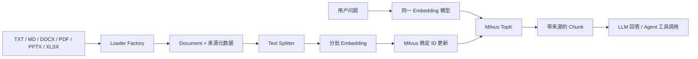

# Multiformat RAG

可复现的多格式知识库 RAG 项目，使用 LangGraph 组织入库与问答，并提供知识库检索工具供 Agent 调用。

```text
PDF / DOCX / PPTX / XLSX / MD / TXT
  → Document → Chunk → Embedding → Milvus
问题 → 同一 Embedding 模型 → Milvus TopK → 带来源的片段 → LLM 回答
```



## 已实现

- 按页、幻灯片或表格行保留来源位置的多格式解析。
- 本地 BGE-M3 或 OpenAI-compatible Embedding API。
- Milvus 稠密向量入库和 TopK 语义检索。
- 基于检索内容的 LLM 问答；无检索结果时直接说明无法回答。
- 入库与查询分别通过 LangGraph 编排。
- 入库按批向量化和写入，日志记录批次和结果；重复执行可继续收敛到最新文件内容。
- Agent 模式可调用知识库检索工具，并限制最多三轮工具调用。

## 一键演示

配置好 `.env` 和 Milvus 后，在项目根目录运行：

```powershell
uv run python -m rag.demo
```

演示程序会在 `E:\Codex\MultiformatRagDemo` 生成**虚构** Markdown 文件，使用独立的 `multiformat_rag_demo` Collection，依次验证入库、检索、LLM 问答、无答案拒答和 Agent 工具调用。逐项回答保存在该目录的 `DemoResult.json`。重复运行会更新同一文件，不会向正式 Collection 添加测试数据。其他设备可通过 `--output-dir` 指定输出目录；只想验证检索时可加 `--retrieval-only`。演示命令不会启动 Web 服务或占用端口。

## 安装与日常使用

Python 3.12。先安装 `pyproject.toml` 中的依赖并准备 Milvus 服务。将 `.env.example` 复制为 `.env`，填入实际配置。真实密钥仅保存在 `.env`，不要提交。

```powershell
uv sync
uv run python -m rag.main index <你的文件路径>
uv run python -m rag.main search "文档讲了什么？"
uv run python -m rag.main ask "文档讲了什么？"
uv run python -m rag.main agent "文档讲了什么？"
```

`index` 会向 Milvus 写入数据。默认集合是 `multiformat_rag_v2`，对同一文件重复执行会更新已有 Chunk，并删除该文件不再存在的旧 Chunk。`search` 不调用 LLM；`ask` 需要 `LLM_BASE_URL`、`LLM_API_KEY` 和 `LLM_MODEL`。入库与查询必须使用同一个 Embedding 模型，切换模型时应使用新的 Collection。索引维度按首次入库的模型确定，现有 Collection 不会自动迁移。

## 从旧集合迁移

原集合 `multiformat_rag` 使用 Milvus 自动生成的整数 ID，其中可能有重复记录。新版默认写入独立的 `multiformat_rag_v2`，**不会删除或修改原集合**。从原始文件重新运行 `index` 即可逐个建立新版数据；文件路径会规范化为绝对路径，Chunk ID 由路径和序号稳定生成。迁移期间，两套数据独立存在，不会自动合并。完成重建并验证检索结果后，可按自己的备份策略决定是否保留旧集合。

如需临时查询旧集合，在 `.env` 中设 `MILVUS_COLLECTION=multiformat_rag` 后运行 `search` 或 `ask`；不要对旧集合运行 `index`，程序会拒绝用旧 Schema 写入。切回新版时设为 `multiformat_rag_v2`。如果原始文件已丢失，旧集合中的记录目前需要单独的迁移程序，不能直接用 `index` 重建。

本地 BGE-M3 默认使用 CUDA；没有可用 GPU 时将 `LOCAL_EMBEDDING_DEVICE` 改为 `cpu`。`LOCAL_EMBEDDING_MODEL_PATH` 可填已下载的本地模型目录。

`INDEX_BATCH_SIZE` 默认 32，可设置为 1–256。显存不足时调小该值。入库 Graph 不再保存整份文件的向量列表，峰值向量内存受批大小限制；Loader 和 Splitter 目前仍会在内存中保留文档与 Chunk。每批写入成功后才处理下一批，所有批次成功后才删除该文件已过期的 Chunk。如果中途失败，可能已有部分新 Chunk 写入，但旧 Chunk 不会被清理；修复问题后重跑同一文件即可继续更新。Milvus 不提供这一跨批流程的原子事务。

## 验证

```powershell
uv run python -B -m unittest discover -s tests -v
```

这些离线测试覆盖格式识别、空内容处理、检索结果映射、回答来源、分批写入、失败保护和重复入库逻辑。真实模型、Milvus 和 LLM 的连通验证需在配置好服务后执行上述命令。

固定题集评估可运行 `python -m rag.evaluate --cases <题集.json> --output <结果.json>`。评估会调用已配置的 Embedding、Milvus 和 LLM，输出 Top1/Top3/Top5 来源命中、关键事实、引用来源及拒答统计；`--rescore-existing` 可在不再次调用模型的情况下重算已有回答。通过 `python -m rag.evaluation_fixtures --output-dir <新目录>` 可从仓库代码生成六种格式的虚构评估资料和 13 道题。当前逐题结果保存在本机 `E:\Codex\RagEvaluation`，与正式知识库使用独立 Collection。在这组小规模合成数据上，11 道可回答题的预期来源 Top1 命中、关键事实和正确来源引用均为 11/11，2 道无答案题均拒答；**这些结果不代表生产环境准确率**。

## 主要目录

| 路径 | 用途 |
| --- | --- |
| `rag/loaders/` | 多格式解析与 Loader Factory |
| `rag/embeddings/` | 本地/API Embedding 接口与工厂 |
| `rag/vectorstores/` | Milvus Schema、更新和检索 |
| `rag/graph.py`、`rag/query_graph.py` | 入库与问答 LangGraph |
| `rag/agent.py` | 知识库检索工具调用 |
| `rag/demo.py`、`rag/evaluate.py` | 演示与固定题集评估 |
| `tests/` | 不依赖外部服务的回归测试 |

## 当前边界

目前采用稠密向量检索和基础工具调用 Agent，已有小规模固定题集评估；尚未实现混合检索、重排、对话记忆或大规模真实业务评估。Agent 模式依赖支持 OpenAI-compatible tool calling 的 LLM。DOCX 暂时只读取普通段落；扫描 PDF 需要另加 OCR。Loader 与 Splitter 仍会把文档和 Chunk 保存在内存中。

本机原有的个人 PDF、IDE 配置和早期练习脚本已从待提交内容中排除，仍保留在本地。公开仓库时只使用演示程序生成的虚构资料，不应提交 `.env` 或真实业务文件。
